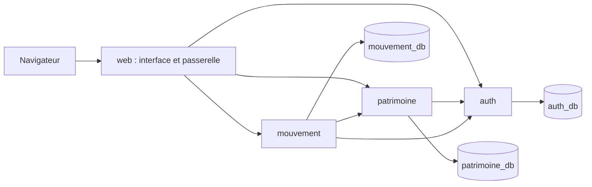

# SIGPE — Système intégré de gestion du patrimoine de l'État

Application de gestion du patrimoine de l'État construite avec Laravel 12, PostgreSQL 16 et Docker Compose. Le projet sépare l'interface web, l'authentification, la gestion du patrimoine et le suivi des mouvements en services distincts.

## Sommaire

- [Fonctionnalités](#fonctionnalités)
- [Architecture](#architecture)
- [Démarrage rapide](#démarrage-rapide)
- [Comptes de démonstration](#comptes-de-démonstration)
- [Utilisation](#utilisation)
- [API](#api)
- [Sécurité](#sécurité)
- [Documentation et limites](#documentation-et-limites)
- [Auteur](#auteur)

## Fonctionnalités

- Gestion des biens, catégories, affectations et mouvements (transfert, maintenance, cession et réforme).
- Gestion des rôles et des organisations : administration centrale, administrateurs locaux, gestionnaires et auditeurs.
- Consultation de l'historique des mouvements et calcul à la volée de la valeur nette comptable.
- Tableau de bord, recherche, filtres, pagination et export CSV de l'inventaire.
- Suivi privé des engagements financiers.
- Catalogue public limité aux biens naturels ou vivants explicitement publiés.

## Architecture

| Service | Responsabilité | Port local |
| --- | --- | ---: |
| `web` | Interface Blade et passerelle API | `8080` |
| `auth` | Utilisateurs, rôles et jetons | `8001` |
| `patrimoine` | Biens, catégories et engagements financiers | `8002` |
| `mouvement` | Mouvements et historique | `8003` |
| `postgres` | Instance PostgreSQL hébergeant les bases des services | réseau Docker uniquement |

Chaque service applicatif possède sa propre base de données (`auth_db`, `patrimoine_db` ou `mouvement_db`). Les services communiquent par API ; les identifiants d'organisation et de bien partagés entre bases sont des références logiques.



## Démarrage rapide

### Prérequis

- Docker
- Docker Compose (commande `docker compose`)

### Lancer l'application

Depuis la racine du dépôt :

```bash
docker compose up --build
```

Au premier lancement, Docker construit les quatre images Laravel. Les migrations et les données de démonstration sont ensuite appliquées automatiquement.

Ouvrir l'interface web à l'adresse **http://localhost:8080**.

Les services API sont également publiés sur `http://localhost:8001` (auth), `http://localhost:8002` (patrimoine) et `http://localhost:8003` (mouvement). PostgreSQL n'est pas publié sur un port de l'hôte ; il est accessible aux services sur le réseau Docker.

Pour arrêter les conteneurs, utiliser `Ctrl+C`. Pour les exécuter en arrière-plan, lancer `docker compose up --build -d`, puis les arrêter avec `docker compose down`.

## Comptes de démonstration

| Rôle | Adresse e-mail | Mot de passe |
| --- | --- | --- |
| Administrateur central | `admin@etat.gov` | `Admin@123` |
| Gestionnaire | `gestionnaire@etat.gov` | `Gest@123` |
| Auditeur | `auditeur@etat.gov` | `Audit@123` |

Ces comptes sont destinés à la démonstration locale. Changez les identifiants et les secrets définis dans `docker-compose.yml` avant tout déploiement.

## Utilisation

L'accueil public (`/`) permet de rechercher et consulter les fiches publiques autorisées. Les autres biens et les données financières sont réservés aux utilisateurs authentifiés. Les biens de démonstration sont privés par défaut ; le catalogue public peut donc être vide au premier démarrage.

L'administration centrale gère ses biens et les espaces qui lui sont rattachés. Les administrateurs locaux et les autres utilisateurs sont limités par leur rôle et leur organisation.

## API

Les routes publiques du service Patrimoine sont :

- `GET /api/public/biens`
- `GET /api/public/biens/{id}`
- `GET /api/public/categories`

Les autres routes requièrent un jeton `Bearer` et appliquent les autorisations et la portée organisationnelle correspondantes. Depuis l'interface web, la passerelle transmet les requêtes sous `/gateway/{service}/...`.

| Service | Routes principales |
| --- | --- |
| Auth | `POST /api/login`, `POST /api/logout`, `GET /api/me`, `GET/POST /api/users`, `GET/POST /api/organisations` |
| Patrimoine | `GET/POST /api/biens`, `GET/PUT/DELETE /api/biens/{id}`, `GET /api/biens/stats`, `GET /api/biens/export`, `/api/engagements-financiers` |
| Mouvement | `GET/POST /api/mouvements` |

Exemple d'appel à l'API via la passerelle avec `curl` et `jq` :

```bash
TOKEN=$(curl -s -X POST http://localhost:8080/gateway/auth/login \
  -H 'Content-Type: application/json' \
  -d '{"email":"admin@etat.gov","password":"Admin@123"}' | jq -r .token)

curl -H "Authorization: Bearer $TOKEN" \
  http://localhost:8080/gateway/patrimoine/biens/stats
```

## Sécurité

Les mots de passe sont hachés, les jetons sont stockés sous forme hachée et les services contrôlent les rôles et les autorisations. L'interface web utilise également la protection CSRF. Les valeurs d'exemple dans `docker-compose.yml` ne conviennent pas à une mise en production : configurez des secrets propres à votre environnement et désactivez tout compte de démonstration.

## Documentation et limites

Les documents de cadrage du projet sont disponibles dans [`docs/`](docs/). Le registre financier est un suivi simplifié et ne remplace pas un logiciel de comptabilité. Le projet ne comprend pas encore de tests automatisés, d'import CSV ou de gestion de pièces jointes. Les mises à jour liées aux mouvements entre services sont synchrones et ne sont pas atomiques.

## Auteur

**Mawoulomi SENOU** — développeur Full Stack Junior
