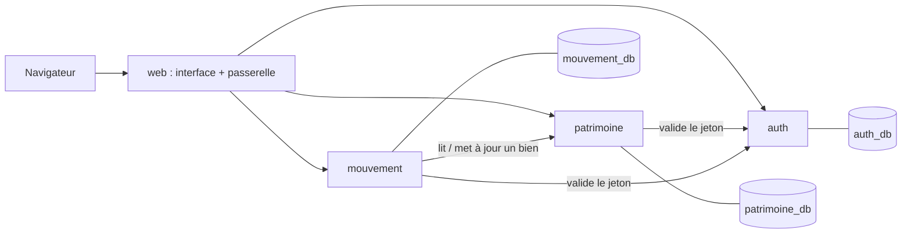
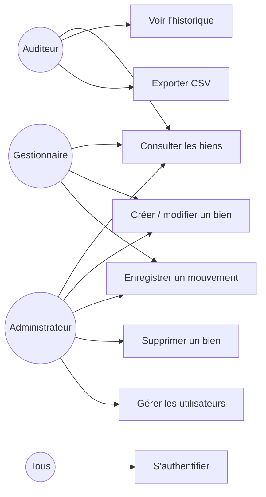
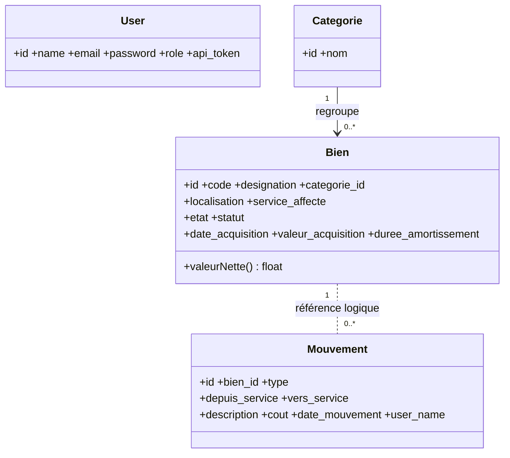
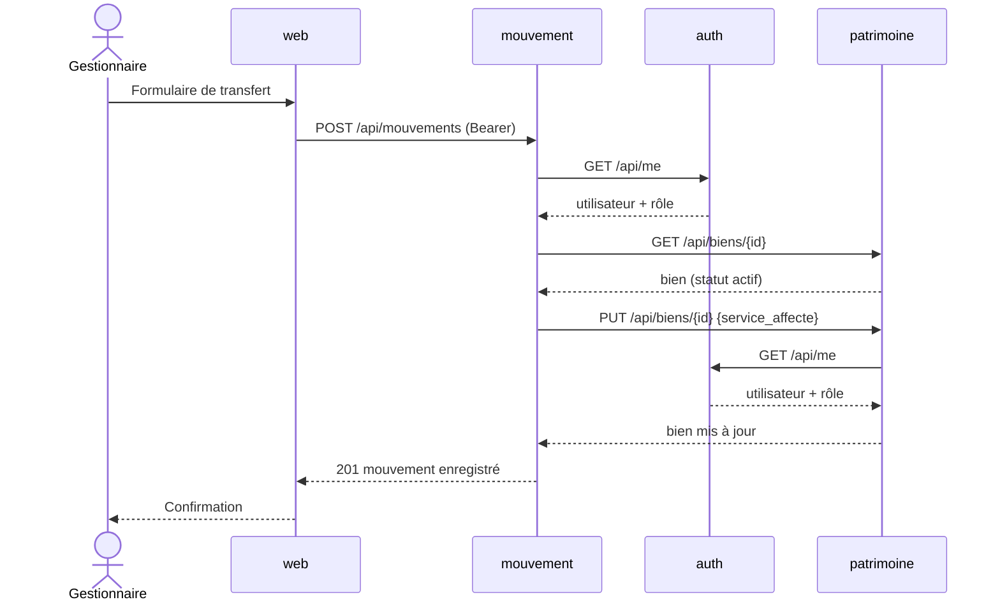
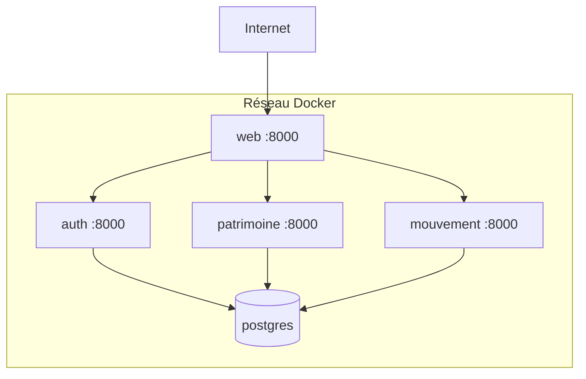

# SIGPE – Système Intégré de Gestion du Patrimoine de l'État

Plateforme de gestion du patrimoine de l'État en **architecture micro-services** (Laravel 11, PostgreSQL 16, Docker).
Projet individuel – Brief « Développement d'une solution numérique (Gestion du patrimoine) » – 10 au 15/11/2026.

## Sommaire
1. [Présentation](#1-présentation) · 2. [Fonctionnalités](#2-fonctionnalités) · 3. [Architecture](#3-architecture) · 4. [Conception UML](#4-conception-uml) · 5. [Base de données et normalisation](#5-base-de-données-et-normalisation) · 6. [Installation](#6-installation) · 7. [Utilisation](#7-utilisation) · 8. [API](#8-api) · 9. [Sécurité](#9-sécurité) · 10. [Déploiement gratuit](#10-déploiement-gratuit) · 11. [Limites et évolutions](#11-limites-et-évolutions) · 12. [Auteur](#12-auteur)

## 1. Présentation
**Problème** : le patrimoine de l'État (bâtiments, véhicules, mobilier, matériel informatique, équipements) est suivi sur papier ou tableurs dispersés : biens non recensés, affectations inconnues, pas d'historique, pas de valeur comptable à jour.

**Solution** : un inventaire centralisé, des mouvements tracés (transfert, maintenance, cession, réforme), un calcul automatique de la valeur nette comptable et un tableau de bord de pilotage, le tout protégé par des rôles.

Le dossier complet (analyse du besoin, cahier de design Figma, fiche technique, proposition financière, guide d'utilisation, plan de soutenance) accompagne ce dépôt.

## 2. Fonctionnalités
- Authentification et rôles : `admin`, `gestionnaire`, `auditeur`
- CRUD des biens, recherche texte, filtres catégorie/statut, pagination
- Transferts d'affectation, maintenance, cession, réforme, avec historique par bien
- Valeur nette comptable (amortissement linéaire, calculée à la volée)
- Tableau de bord : totaux, répartition par catégorie, biens à réformer
- Export CSV de l'inventaire
- Accueil public et consultation en lecture seule des biens, sans connexion
- Passerelle API (`/gateway/{service}/...`)

## 3. Architecture

| Service | Rôle | Port local | Base |
|---|---|---|---|
| `web` | Interface Blade/Tailwind + passerelle API | 8080 | aucune (session fichier) |
| `auth` | Utilisateurs, rôles, jetons | 8001 | `auth_db` |
| `patrimoine` | Biens, catégories, statistiques, export | 8002 | `patrimoine_db` |
| `mouvement` | Mouvements et historique | 8003 | `mouvement_db` |
| `postgres` | Une instance, 3 bases | 5432 | – |

Principes : une base par service ; aucune jointure inter-services ; le service Mouvements modifie un bien **uniquement via l'API du service Patrimoine** ; chaque service valide le jeton en appelant `GET /api/me` du service Auth.



## 4. Conception UML

### Cas d'utilisation


### Diagramme de classes


### Séquence : transfert d'un bien


### Déploiement


## 5. Base de données et normalisation
```
auth_db       users(id, name, email UNIQUE, password, role, api_token UNIQUE, timestamps)
patrimoine_db categories(id, nom UNIQUE)
              biens(id, code UNIQUE, designation, categorie_id FK, localisation, service_affecte,
                    etat, statut, date_acquisition, valeur_acquisition, duree_amortissement, timestamps)
mouvement_db  mouvements(id, bien_id, type, depuis_service, vers_service, description,
                         cout, date_mouvement, user_name, timestamps)
```
- **1FN** : valeurs atomiques, pas de groupes répétitifs.
- **2FN** : clés simples (`id`), pas de dépendance partielle.
- **3FN** : la catégorie est isolée ; la valeur nette est calculée, jamais stockée.
- **Choix assumés** : `bien_id` (mouvements) est une référence logique entre bases ; `user_name` est une copie volontaire pour garder un historique d'audit lisible.

## 6. Installation
Prérequis : Docker et Docker Compose.
```bash
git clone <url-du-depot> && cd gestion-patrimoine-etat
docker compose up --build
```
Le premier démarrage est long (Laravel est téléchargé pour chaque service). Puis ouvrir http://localhost:8080.

| Rôle | E-mail | Mot de passe |
|---|---|---|
| Administrateur | admin@etat.gov | Admin@123 |
| Gestionnaire | gestionnaire@etat.gov | Gest@123 |
| Auditeur | auditeur@etat.gov | Audit@123 |

Changer ces mots de passe et les secrets PostgreSQL de `docker-compose.yml` avant toute mise en ligne.

## 7. Utilisation
L'accueil public (`/`) permet de rechercher, filtrer et consulter les fiches des biens sans connexion. Pour accéder au tableau de bord, à l'export et aux fonctions de gestion, se connecter puis ouvrir l'inventaire. Les fiches publiques sont en lecture seule ; la modification et l'enregistrement de mouvements restent réservés aux rôles autorisés. Suppression réservée à l'administrateur.

## 8. API
Les routes publiques de consultation du service Patrimoine ne demandent pas de jeton. Les autres routes API exigent `Authorization: Bearer <token>`.

| Service | Méthode et route | Rôles |
|---|---|---|
| auth | `POST /api/login`, `POST /api/logout`, `GET /api/me` | tous |
| auth | `GET/POST /api/users` | admin |
| patrimoine | `GET /api/biens` (`q`, `categorie_id`, `statut`, `page`), `GET /api/biens/{id}`, `GET /api/categories` | public, lecture seule |
| patrimoine | `GET /api/biens/stats`, `GET /api/biens/export` | tous les rôles authentifiés |
| patrimoine | `POST /api/biens`, `PUT /api/biens/{id}`, `POST /api/categories` | admin, gestionnaire |
| patrimoine | `DELETE /api/biens/{id}` | admin |
| mouvement | `GET /api/mouvements` (`bien_id`, `type`) | tous |
| mouvement | `POST /api/mouvements` | admin, gestionnaire |

Exemple via la passerelle :
```bash
TOKEN=$(curl -s -X POST localhost:8080/gateway/auth/login -H 'Content-Type: application/json' \
  -d '{"email":"admin@etat.gov","password":"Admin@123"}' | jq -r .token)
curl -H "Authorization: Bearer $TOKEN" localhost:8080/gateway/patrimoine/biens/stats
```

## 9. Sécurité
Mots de passe hachés (bcrypt), jetons hachés (SHA-256) en base, contrôle des rôles dans chaque service, validation de toutes les entrées, CSRF actif sur l'interface web.

## 10. Déploiement gratuit
Les offres gratuites (Render, Koyeb, Fly.io, etc.) changent souvent : vérifier leurs limites actuelles. Démarche type : pousser le dépôt sur GitHub, créer une base PostgreSQL gratuite, créer un service par dossier `services/*` avec `docker/Dockerfile` (argument de build `SERVICE`), définir les variables `AUTH_URL`, `PATRIMOINE_URL`, `MOUVEMENT_URL`, `DB_*`, `RUN_MIGRATIONS` comme dans `docker-compose.yml`. Les offres gratuites mettent les services en veille : prévoir un temps de réveil, et garder la démonstration locale (`docker compose`) en secours pour l'oral.

## 11. Limites et évolutions
Pas de tests automatisés ; pas d'import CSV ni de pièces jointes ; passerelle simple (à remplacer par Traefik ou Kong) ; cohérence entre services synchrone (évolution : événements et saga) ; gestion des utilisateurs disponible par l'API seulement.

## 12. Auteur
Mawoulomi SENOU – développeur Full Stack Junior
# gestion-patrimoine-etat

